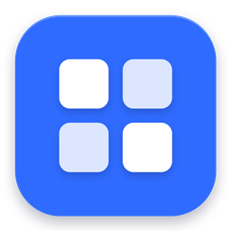
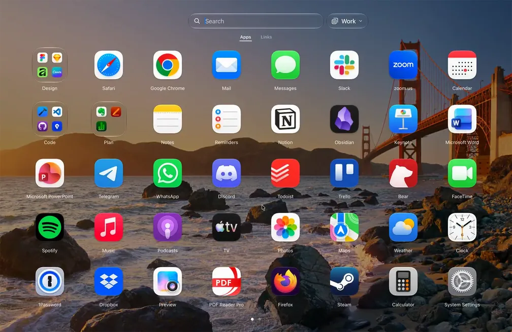
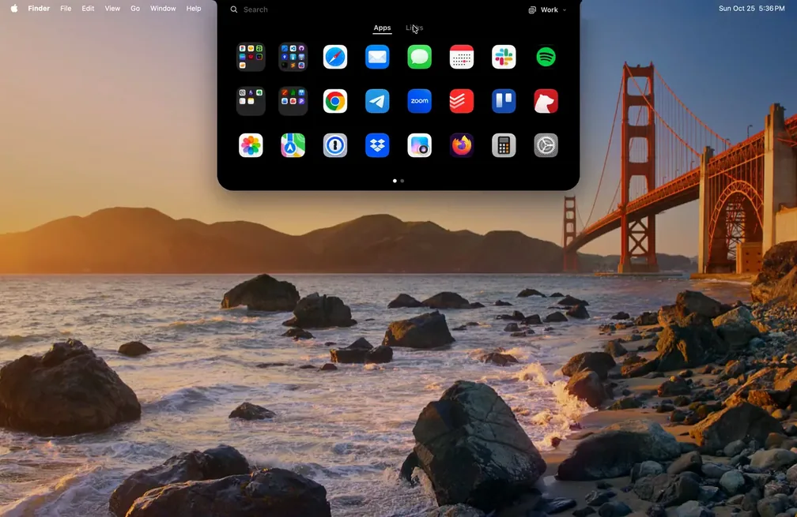
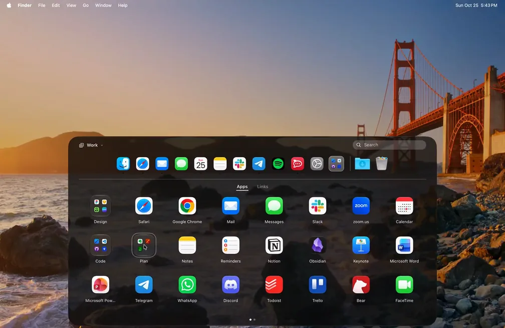
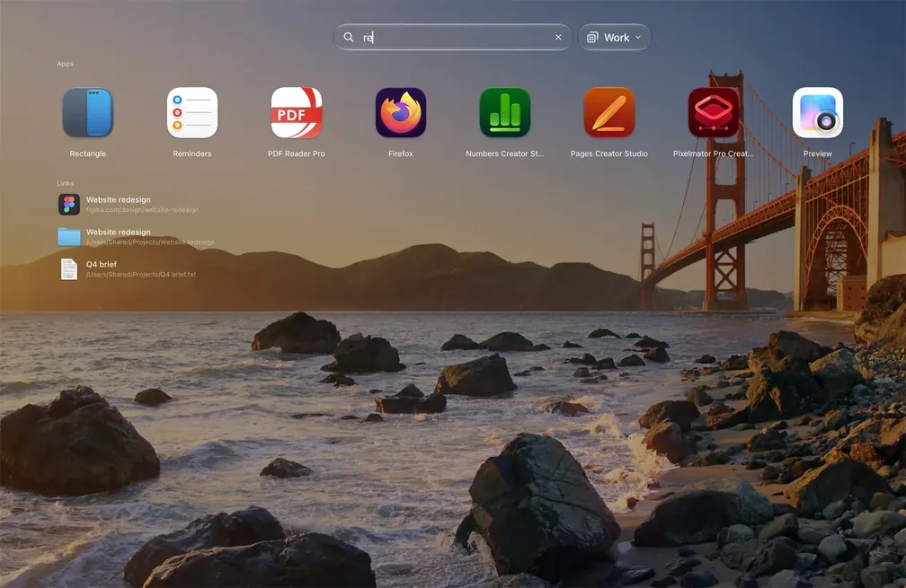
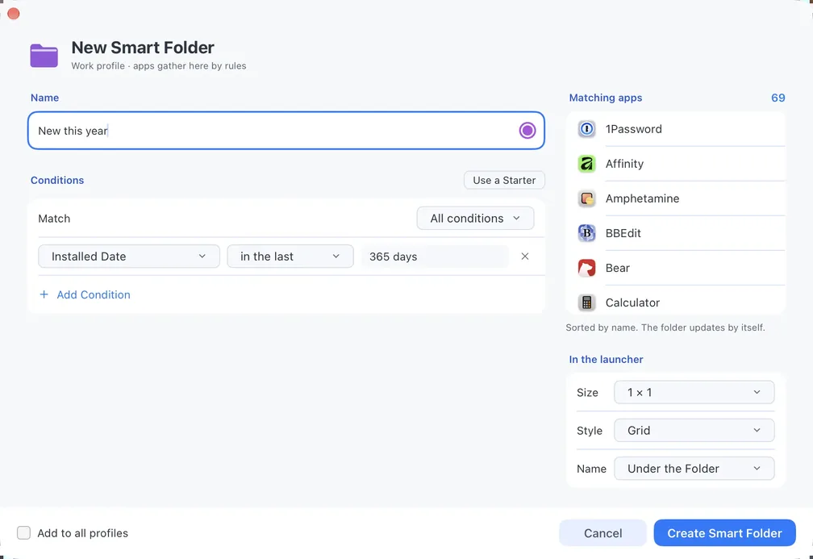
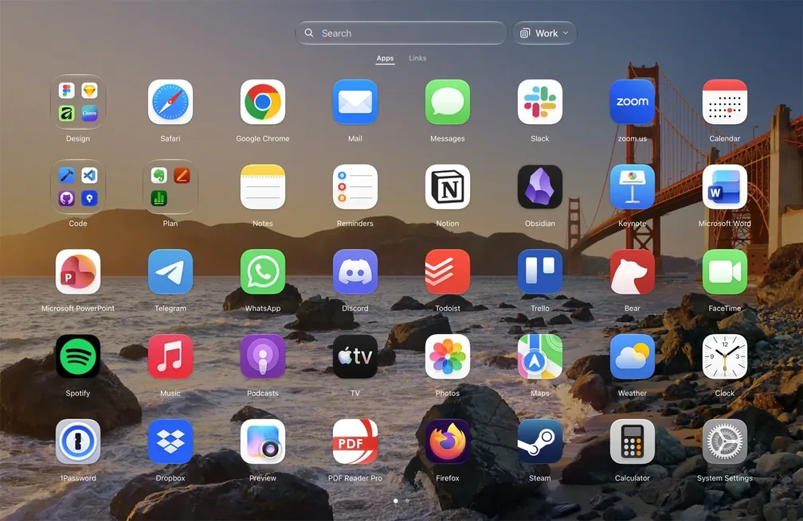
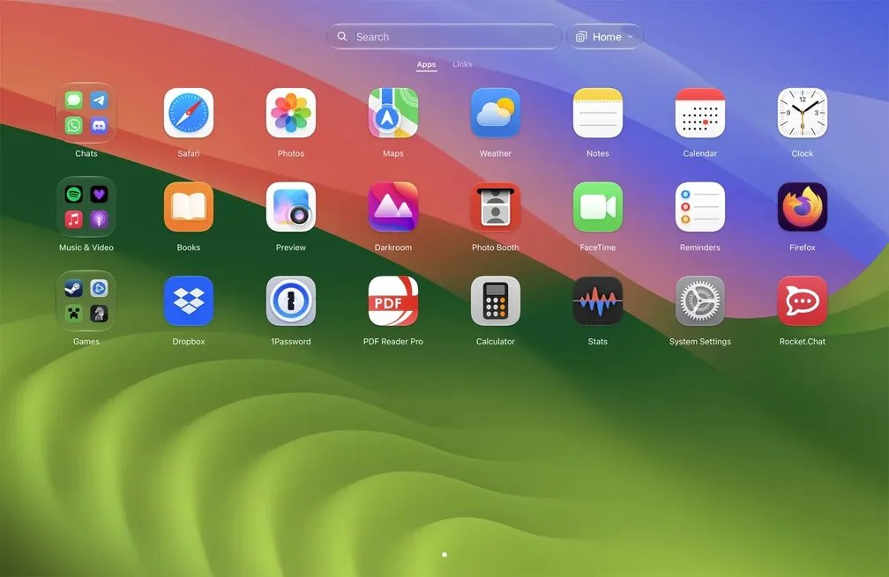

  

<h1 align="center">ModusPad</h1>

  <b>Launchpad and Dock, the way you want them.</b> 
  Put your launcher full screen, in the notch, or in your Dock. Group apps in the Dock, give each desktop its own.

  <a href="https://moduspad.com/download?utm_source=github"><b>Download</b></a> ·
  <a href="https://moduspad.com/?utm_source=github">Website</a> ·
  <a href="https://moduspad.com/changelog?utm_source=github">Changelog</a> ·
  <a href="https://github.com/VladyslavZubkov/ModusPad/issues">Report a bug</a>

  14-day free trial · No credit card required 
  Requires macOS 26 or later · Notarized by Apple

  

## Why ModusPad

macOS 26 replaced Launchpad with an app list: no pages, no folders, no order of your own. ModusPad brings the grid back —
and lets you choose where it lives: full screen, in the notch, or in a Dock of your own that opens into your whole grid.
Profiles give each part of your day its own launcher and its own apps, and switch between them by themselves.

## Features

- **Three ways to launch.** For each profile: a classic Full Screen launcher, a panel that slides out of the notch, or
  your Dock.
- **Your Dock, your way.** Dock mode replaces the macOS Dock with your own. Keep apps, folders, files and links in it, then
  swipe up with two fingers or press ⌥ Space to open it into your grid. Recent apps and minimized windows work as in the
  macOS Dock, and your original Dock comes back when you switch away.
- **Groups in the Dock.** A group takes one place in the Dock and opens right in the row. Drag a folder from your grid onto
  the Dock, or ⌘-click a few apps and press ⌘G.
- **A Dock for every desktop.** Keep a different set of Dock apps on each macOS desktop.
- **Links, next to your apps.** Keep the sites, folders and files you open every day in a Links tab. Press ⌃⌥L to add a
  selected link, file or the page open in your browser. One search finds apps and links.
- **Profiles that switch by themselves.** Each profile has its own layout, hidden apps and apps to open, and runs your
  shortcuts from the Shortcuts app. It turns on with a Focus, when a display connects, on a schedule or with its own
  keyboard shortcut.
- **Arrange it your way.** Pages, folders, drag & drop, select many at once, ⌘Z. Bring over your old Launchpad layout in
  one click.
- **Smart folders.** Folders that fill themselves by your rules: name, category, App Store or Homebrew, when an app was
  installed or last opened, how often you launch it. Make any folder up to 3 × 3 and see its apps right on the page.
- **In your language.** English, Deutsch, Français, 日本語, Español, Português, Italiano, 한국어, 简体中文, 繁體中文.
- **Private.** No account, no tracking — your layouts stay on your Mac. ModusPad never deletes or moves anything on disk.

  
  

  
  

  
  

## Install

1. [Download ModusPad](https://moduspad.com/download?utm_source=github) (a notarized DMG).
2. Open it and drag **ModusPad** to **Applications**.
3. Open ModusPad — the setup takes about a minute.

ModusPad updates itself. Homebrew: coming to the official cask.

## Pricing

Try every feature free for 14 days. Then a one-time purchase for 1, 2 or 5 Macs —
[see prices](https://moduspad.com/#pricing). After the trial, ModusPad keeps working with some limitations —
[see what changes](https://moduspad.com/after-trial?utm_source=github).

## Feedback

Found a bug or have an idea? [Open an issue](https://github.com/VladyslavZubkov/ModusPad/issues/new/choose) or write to
[support@moduspad.com](mailto:support@moduspad.com).

---

This repository holds the public page, releases and issue tracker of ModusPad. The app is closed source.
© 2026 ModusPad. Created by Vladyslav Zubkov · [Terms](https://moduspad.com/terms) · [Privacy](https://moduspad.com/privacy)
